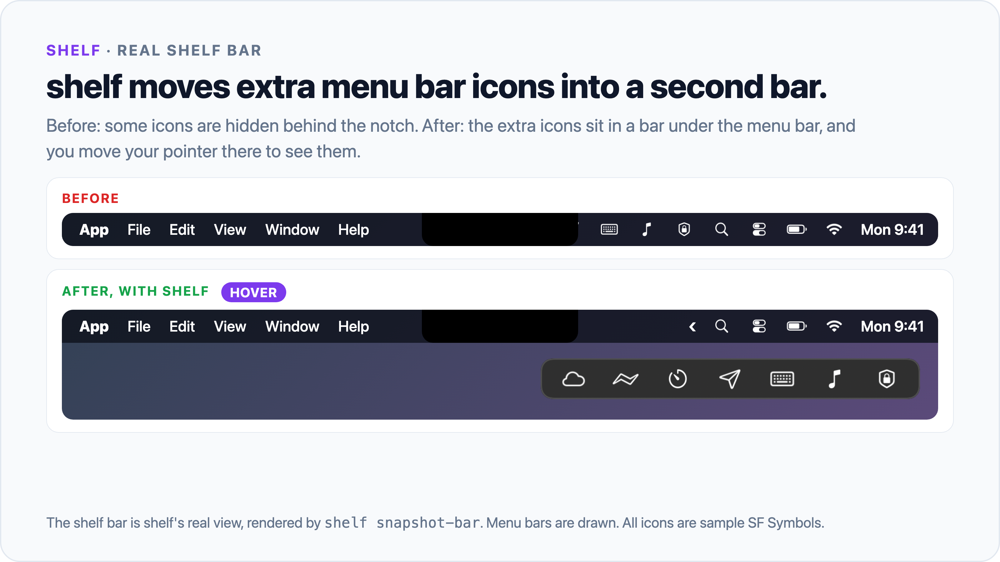
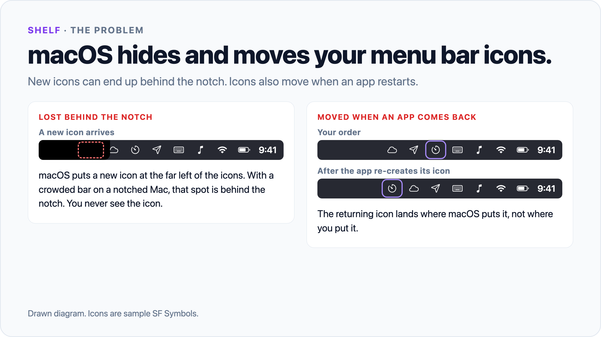
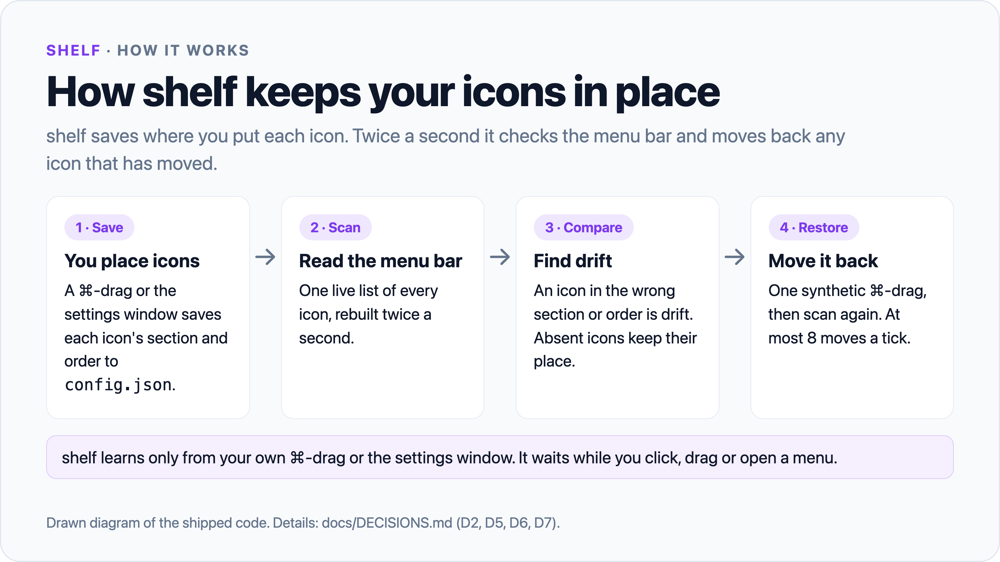

# shelf

shelf is a small menu bar manager for macOS 26. It keeps your menu bar icons where you put them. It moves extra icons into a second bar under the menu bar.



```sh
git clone https://github.com/AaqifZ/shelf.git && cd shelf
scripts/install.sh
~/.local/bin/shelf use shelf
```

## Why



Apps add and remove their menu bar icons whenever they like. When an icon comes back, macOS puts it wherever it wants, and you drag it back by hand. Ice and similar menu bar managers hide icons, but Ice saves no layout, so it cannot put a drifted icon back.



shelf remembers where each icon belongs and moves it back when it drifts. It is small: about 3,000 lines of Swift, no dependencies.

## Install

You need:

- macOS 26. shelf is tested only on macOS 26. It does not run on older versions.
- Swift 5.9 or later. The Xcode Command Line Tools include it (`xcode-select --install`).

Steps:

1. Optional, once per Mac: run `scripts/make-signing-cert.sh`. It adds a self-signed certificate named `shelf-local` to your login keychain. With it, macOS keeps shelf's permissions when you rebuild. Without it, shelf is signed ad hoc, and each rebuild asks for the permissions again.
2. Run `scripts/install.sh`.
3. Run `~/.local/bin/shelf use shelf`. If `~/.local/bin` is on your `PATH`, `shelf use shelf` is enough.
4. When macOS asks, give Shelf.app the Accessibility permission and the Screen Recording permission. Until it has both, shelf shows a ⚠︎ icon with buttons to the right settings.

What `scripts/install.sh` changes on your Mac:

- It builds shelf and writes `~/Applications/Shelf.app`.
- It links the command `~/.local/bin/shelf`.
- It writes the login agent `~/Library/LaunchAgents/com.aaqifz.shelf.plist`. The agent starts shelf at login and restarts it if it quits. The agent stays off until you run `shelf use shelf`.

shelf writes its own files in `~/.shelf/`. Errors from the login agent go to `~/.shelf/shelf.err`. Nothing else changes.

To remove shelf, run `scripts/uninstall.sh`. It removes the app, the command and the login agent, and opens Ice if you have it. It keeps `~/.shelf/` and the `shelf-local` certificate. To remove the certificate, run `security delete-identity -c shelf-local`.

## Use

- Hover, click or scroll on empty menu bar space to show the hidden icons. You can also press ⌥⌘, or click `‹`.
- Click a hidden icon in the shelf bar. shelf shows it in the menu bar, clicks it, and hides it again when its menu closes.
- Right-click `‹` to open the settings window. Drag icons between the Visible and Hidden rows.
- In the menu bar, ⌘-drag an icon just left of `‹` to hide it. ⌘-drag it right of `‹` to show it.
- New icons start hidden.

| Command | Result |
|---|---|
| `shelf list` | Shows every icon, left to right, with its section. Add `--debug` for unmatched windows. |
| `shelf check` | Compares the menu bar, the shelf bar, the settings window and the memory. Exit code 1 means a problem. Exit code 3 means Shelf is safely paused. |
| `shelf settings` | Opens the settings window. |
| `shelf place hidden\|visible <id>` | Moves an icon to a section. |
| `shelf restart` | Restarts the app. |
| `shelf snapshot-bar <file.png>` | Renders the shelf bar with sample icons to a PNG. It does not read your menu bar. |
| `shelf use shelf` | Starts shelf. If Ice runs, shelf copies Ice's layout first, then quits Ice. |
| `shelf use ice` | Stops shelf and opens Ice, if you have it. |

You do not need Ice. If you use it, shelf and Ice take turns: only one runs at a time.

## How it works

1. shelf adds two items to the menu bar: the `‹` icon and a divider. The divider is very long and pushes every icon on its left off the screen.
2. Twice a second, shelf reads the menu bar and builds one live list of icons.
3. shelf remembers the section and the order of each icon in `~/.shelf/config.json`.
4. When an icon is in the wrong place, shelf moves it back with a synthetic ⌘-drag. It does one move, reads the menu bar again, and plans the next move.
5. The menu bar, the shelf bar and the settings window draw from the same live list.
6. shelf learns a new layout only from a whole ⌘-drag that you make, or from the settings window.

Every design choice and its reason is in [docs/DECISIONS.md](docs/DECISIONS.md).

| File | Content |
|---|---|
| `~/.shelf/config.json` | The layout memory and the options. |
| `~/.shelf/state.json` | What the app and its views show now. `shelf check` reads it. |
| `~/.shelf/shelf.log` | Every move, click and decision. |
| `~/.shelf/check.log` | The result of the hourly check. |

### Tests

- `scripts/verify-reliability.sh` builds every target and runs the four offline suites. It does not install Shelf or move icons.
- `swift run ShelfSelfTest` tests the planner, layout memory and health check.
- `swift run ShelfDisplayTest` tests display selection and ambiguous ownership.
- `swift run ShelfRecoveryTest` tests retry limits, cooldowns and window recreation.
- `swift run ShelfPersistenceTest` tests configuration failures, atomic saves and log rotation.
- `node --test scripts/watch.test.mjs` tests the live movement brake.
- `swift run ShelfChurn "$(which shelf)" 50` is the live test that docs/DECISIONS.md calls Test 1. A test icon appears and disappears 50 times. shelf must put it back in Visible each time, and `shelf check` must pass each time. It moves real icons, so do not run it while you work.

After a new build starts, `node scripts/watch.mjs 180 15` watches for three minutes. It stops Shelf above 15 moves or when log continuity fails.

## Limits

- This is a personal project. It has no support and no updater.
- shelf is tested on macOS 26 only. It depends on how macOS 26 handles menu bar windows and events.
- shelf uses private WindowServer calls and posts synthetic mouse events. A macOS update can break it.
- shelf selects the real menu bar strip on the display that contains its icon. Physical display transitions remain early and need more real-world testing.
- While the shelf bar or the settings window is open, shelf captures icon pictures, so macOS shows its Screen Recording indicator.
- macOS indicators, such as the microphone-in-use icon, cannot move. shelf leaves them alone.
- Icons cannot go right of the Control Center icons (Wi-Fi, Battery and the others). shelf keeps app icons to their left.
- The reliability update passed 98 offline assertions and a bounded live gate with zero moves. Longer real-world soak testing remains open. Treat shelf as early software.

Built with AI coding agents.

## License

GPLv3. See [LICENSE](LICENSE).

shelf adapts some mechanisms from [Ice](https://github.com/jordanbaird/Ice) and [Thaw](https://github.com/thaw-app/Thaw), both GPLv3. See [NOTICE](NOTICE) for the authors and the files.
